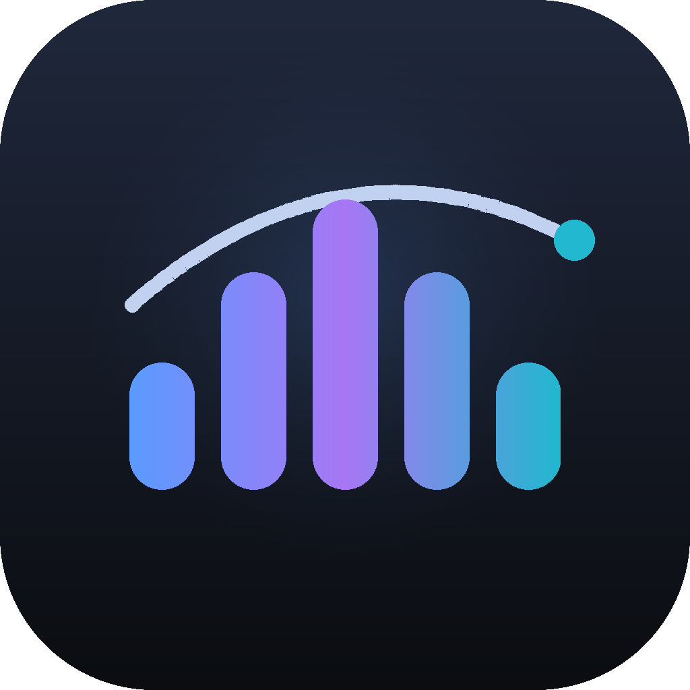
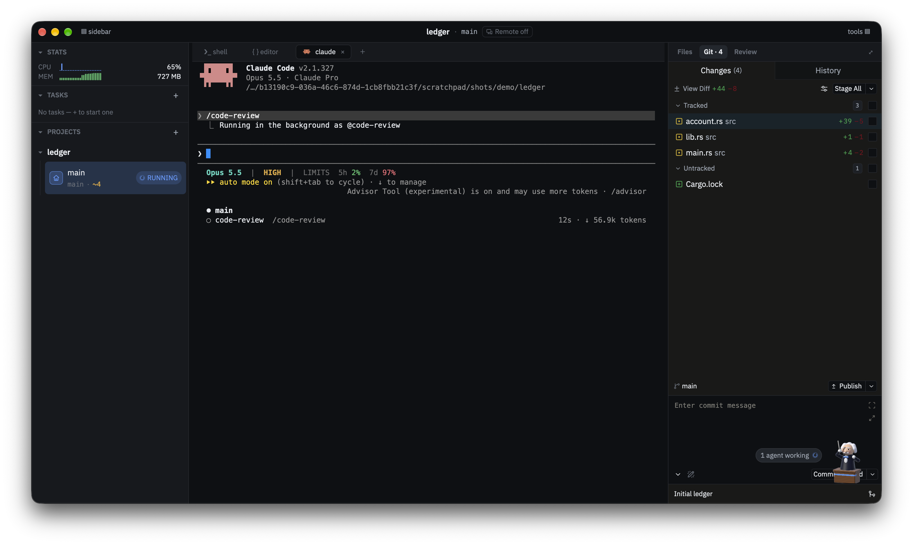
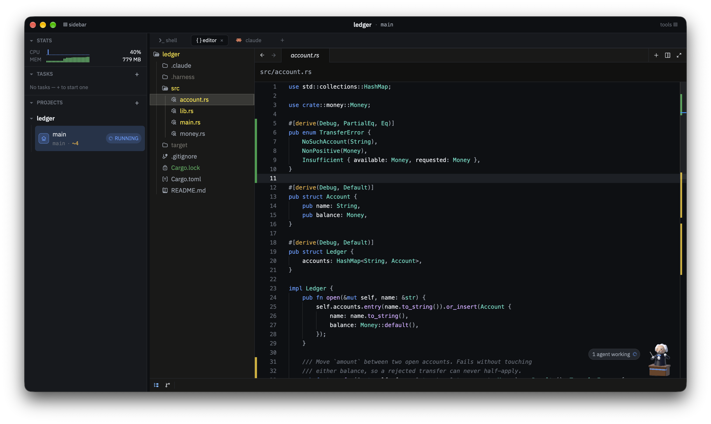
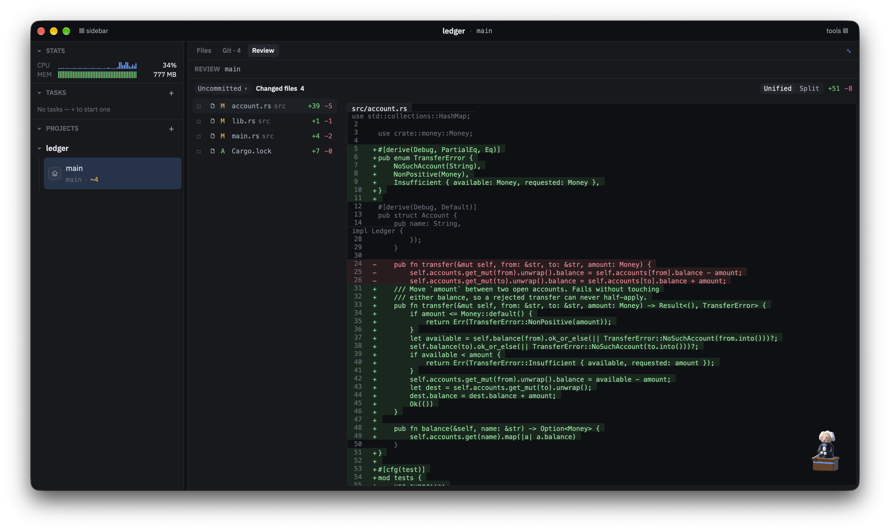

<p align="center">
  
</p>

<h1 align="center">openOrchestra</h1>

<p align="center">
  <a href="https://github.com/omarpr/openorchestra/actions/workflows/ci.yml"></a>
  <a href="https://github.com/omarpr/openorchestra/releases/latest"></a>
  <a href="LICENSE"></a>
</p>

A native macOS workspace for running coding agents in parallel Git worktrees, editing
with Zed, and reviewing changes before you ship. openOrchestra runs locally and
requires no openOrchestra account. It collects no telemetry.



## Install

```sh
brew install --cask omarpr/tap/openorchestra
```

Or download the signed, notarized universal DMG for Apple Silicon and Intel.
[GitHub Releases](https://github.com/omarpr/openorchestra/releases/latest)

Requires **macOS 12 or later**, **Git**, and **tmux**. Homebrew installs tmux with
the app. Install and sign in to the agent CLI you want to use. Install and
authenticate `gh` to show pull request and CI status.

## Features

- **Parallel tasks.** Press `⌘N` to start a task on its own branch and worktree.
  Multi-repository tasks can run a specialist in each repo and a coordinator
  that delegates over a local A2A broker. Setup and teardown hooks can prepare
  or clean up worktrees.
- **Agent and shell tabs.** Run OpenCode, Claude Code, Codex, pi, Kimi, Grok, or
  a custom CLI. tmux keeps sessions running when you quit and lets you reattach
  when you reopen the app. The sidebar tracks agent activity, Git changes, pull
  requests, and CI. Native notifications take you back to agents that need input.
- **Embedded Zed editor.** Open the editor with `⌘E`. Browse files, quick-open
  with `⌘P`, search the project, preview Markdown, and use syntax highlighting
  and language-server support.
- **Diff review.** Choose a comparison base, switch between unified and split
  diffs, mark files reviewed, and leave line comments. Copy comments into an
  agent prompt or save them as Markdown.
- **Review Overview.** Generate a branch and working-tree review with Codex,
  Claude Code, pi, or Grok. Follow the report’s links into the editor and open
  a follow-up chat with supported agents.
- **Local development servers.** The Ports panel finds listening services,
  including Docker-published ports, and lets you open or copy their URLs.
  WebKit browser tabs can open local development links alongside the editor and
  terminals. [Browser tabs are unreleased](CHANGELOG.md#unreleased).
- **Phone and tablet access.** Share individual agent or shell tabs on your
  local network. Follow conversations or use the terminal, send replies and
  screenshots, and dictate on supported Macs. [Remote setup](docs/remote-control.md)
- **Resource monitoring.** See CPU and memory usage for the app and its
  worktrees, including agent processes.

<details>
<summary>Editor and diff review screenshots</summary>





</details>

## Develop

Run `make run` for the debug app or build a local app bundle.

```sh
make setup && make app && open dist/openOrchestra.app
```

View or rebind shortcuts in **Settings → Shortcuts** (`⌘,`).
[Development setup and contribution guide](CONTRIBUTING.md#development-setup)

### Windows (experimental)

The app also builds natively on Windows 10/11, with no admin rights and no
Visual Studio: rustup with the GNU toolchain as its default (`rustup default
stable-x86_64-pc-windows-gnu`) and [WinLibs](https://winlibs.com) GCC (POSIX
threads, MSVCRT) in `~\tools\mingw64` or `$env:OO_MINGW`. From PowerShell:

```powershell
.\make setup     # check the toolchain
.\make run       # build and run the debug app
.\make install   # release build, installed per user with a Start menu entry
```

Browser tabs use Edge WebView2 and notifications are Windows toasts. Agents
launch through Git Bash. There is no tmux on Windows: the app bundles
`oo-session.exe`, which keeps agents and shells running after you quit, and
their tabs reattach when you reopen the app. Closing a tab ends its session.
⌘ shortcuts are Alt in the app and Ctrl in the editor (**Settings →
Shortcuts**, `Alt+,`).

## Community

Join the [Slack community](https://join.slack.com/t/openorchestra-group/shared_invite/zt-4h5n9li83-bbPit9xyTUvizQt7wh9bgQ),
report bugs or request features in [GitHub Issues](https://github.com/omarpr/openorchestra/issues),
or follow the [security reporting policy](SECURITY.md).

## Contributors

<table>
  <tr>
    <td align="center">
      <a href="https://github.com/omarpr">
        <br>
        <sub><b>omarpr</b></sub>
      </a>
    </td>
    <td align="center">
      <a href="https://github.com/joeswiggin">
        <br>
        <sub><b>joeswiggin</b></sub>
      </a>
    </td>
    <td align="center">
      <a href="https://github.com/jakesorce">
        <br>
        <sub><b>jakesorce</b></sub>
      </a>
    </td>
  </tr>
</table>

See all [contributors](https://github.com/omarpr/openorchestra/graphs/contributors).

[Changelog](CHANGELOG.md) · [Code of Conduct](CODE_OF_CONDUCT.md) · [GPL-3.0-or-later](LICENSE)
