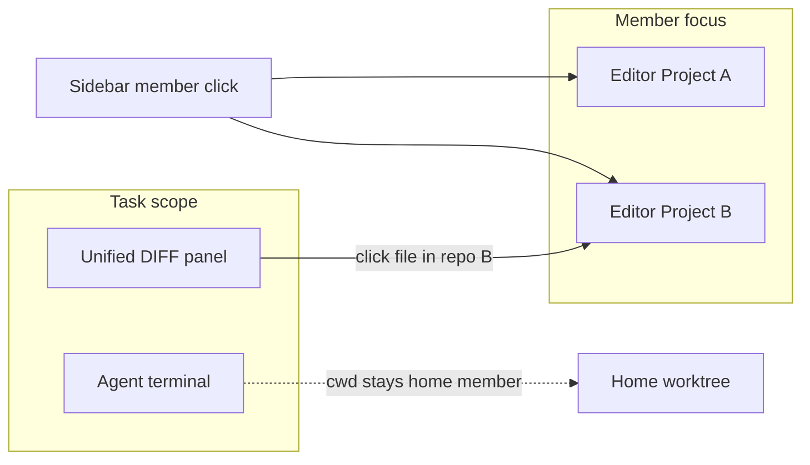

# Worktree bootstrap scripts and task-centric multi-repo UX

**Status:** Draft — pending design approval  
**Date:** 2026-07-26  
**Branch:** `feat/worktree-bootstrap-scripts`

## Summary

Add hybrid (committed + local) setup/teardown hooks for worktree lifecycle, then elevate the **Task** to a project-agnostic parent so one effort can span multiple repository worktrees with a single driving agent and a unified changeset.

## Goals

1. Configure setup and teardown scripts that run in the terminal when a worktree (task member) is created or archived/deleted.
2. Support coordinated multi-repo work: one task, N member projects, one agent, one reviewable change set; editors switch per member (especially via DIFF clicks) without restarting the agent.

## Design decisions (locked)

- **Hook config is hybrid:** committed `.openorchestra/hooks.toml` per repo, overridden by `~/.openorchestra/hooks/<repo>.toml`.
- **Local hook override merge is replace, not append:** when local config sets `scripts`, that list fully replaces the committed list.
- **The parent object is the Task** (today’s “worktree” / effort), not the repository. A task has **one or more member projects**, each backed by a git worktree. Single-repo work is just a task with one member.
- **One task ⇒ one driving agent ⇒ one unified changeset.** The agent session and the right-hand DIFF panel belong to the **task**. The center editor/file tree belong to the **focused member project** and can switch without restarting the agent.
- **Agent cwd** remains a real git worktree (the task’s designated **home member**), with a brief harness-written `AGENTS.md` listing sibling absolute paths. Do **not** make a meta-directory the agent cwd.
- **Home member at create time:** first selected project is presumed home, but home must be changeable in the create UI before creation is initiated (explicit choice, convenient default).
- **Projects foot stays in the sidebar** as first-class inventory: selecting a project opens its main checkout with editor **and** terminal (and the ability to spin up an agent) for maintenance — e.g. pull latest on the default branch, or explore/ask questions without starting a task.
- **Migrate existing worktrees on rollout:** every active (and archived) registry worktree without a `task_id` is converted into a single-member Task so nothing is orphaned or lost. See Migration below.
- Task-level setup/teardown (outside repos) runs before/after per-member hooks.

## UX

Today the sidebar is `Repo → worktrees`, and selection resolves to a single path that owns agent + editor + diff together (`resolve` / `ensure_pane` in `crates/harness-app/src/workspace/state.rs`). That couples “where the agent lives” to “what the editor shows,” which fights cross-service work.

Proposed mental model:

```text
TASKS
  ├─ add-auth-across-services          ← select task: agent + unified DIFF
  │    ├─ thisismyjam   feat/...       ← select member: editor/Project for that repo
  │    ├─ getcookin     feat/...
  │    └─ openorchestra feat/...       (home — agent cwd)
  └─ fix-sidebar-scroll                ← single-member task (today’s worktree)
       └─ openorchestra feat/...
PROJECTS (sidebar foot — inventory + maintenance)
  └─ main checkouts: editor + terminal + optional explore agent
```

| Surface | Owned by | Behavior |
|---|---|---|
| Left sidebar parent | **Task** | Create / archive / delete / rename the effort |
| Left sidebar children | **Member projects** | Focus editor context only |
| Terminal / agent tab | **Task** | One tmux session; cwd = home member; survives member focus changes |
| Right DIFF panel | **Task** | Union of all members’ diffs, grouped by repo |
| Center editor / file tree | **Focused member** | Clicking a DIFF row switches focus to that member and opens the file |
| Projects foot | **Main checkout** | Editor + terminal (+ optional agent) for pull/sync, browse, ask questions — not a task |

Clicking a change in the changeset is the primary navigation gesture for cross-repo exploration.



### Why not an external meta-directory as agent cwd

| Approach | Verdict |
|---|---|
| External dir + `AGENTS.md` as cwd | Rejected for v1: no real git root; editor/diff/forge/agent CLIs assume a repo |
| Home member worktree + brief `AGENTS.md` | Chosen: agents already auto-read `AGENTS.md`; cwd stays a real project; siblings are absolute paths |
| Env-only | Optional later; file is more reliably ingested across CLIs |

## Phase 1 — Hook config model (headless)

Add a hooks module in `crates/worktrees` (keeps create/archive path testable without GPUI).

```toml
# .openorchestra/hooks.toml  (committed in each repo)
[setup]
scripts = ["scripts/worktree-setup.sh"]

[teardown]
scripts = ["scripts/worktree-teardown.sh"]
```

- Local override at `~/.openorchestra/hooks/<repo>.toml` (same shape).
- **Merge rule (locked):** local `scripts` **replace** the committed list when present — never append.
- Script path resolved from the main checkout (`repo_root`); execute with **cwd = member worktree path**.
- Env: `HARNESS_REPO_ROOT`, `HARNESS_WORKTREE`, `HARNESS_BRANCH`, `HARNESS_TASK_SLUG`, plus for multi-member tasks `HARNESS_TASK_ID` and `HARNESS_HOME_WORKTREE`.
- API sketch: `HooksConfig::load(...)`, `run_setup(...)`, `run_teardown(...)`.
- Failure policy: setup failure surfaces in the UI note and leaves members created (user can fix/retry); teardown failure is noted but does not block archive/delete.

## Phase 2 — Hooks on create / archive / delete

- After member `Manager::create`: run that repo’s setup hooks in the task’s shell/tmux session when visible (prefer sending a bounded command into the plain shell tab).
- Before archive/delete (while the worktree dir still exists): run teardown.
- Task-level scripts under `~/.openorchestra/tasks/<slug>/` run **before** member setups and **after** member teardowns.

## Phase 3 — Task as first-class model

```text
Task {
  id, name, slug,
  home_repo,                          // agent cwd member
  members: [{ repo, worktree_id, path, branch }],
  agent_kind,
  created_at, archived
}
```

- Persist task index (e.g. `~/.openorchestra/tasks.json`) + keep per-git-worktree rows in `registry.json` with `task_id`.
- **Create task:** name + select 1..N projects from `repos.json` + choose home member → create a git worktree per member (shared slug/branch grammar) → task setup → per-member hooks → write home `AGENTS.md` → select the new task.
- **Archive/delete task:** task teardown → per-member teardown → existing git archive/delete for each member → drop task record.
- Single-repo “＋” today becomes “create task with one member” (same gesture, richer model underneath).
- Home member: first selected project is the default; create UI must allow changing home before confirm.

## Phase 4 — Selection, panes, and unified DIFF

### Selection

Two-level selection:

- `Selection::Task(task_id)` — task focused; member focus = last-focused or home
- `Selection::TaskMember { task_id, worktree_id }` — same task scope, editor on that member

Agent/diff resolution always uses `task_id`. Editor/`Project` resolution uses the focused member’s path.

### Panes

Split today’s single `panes[worktree_key]`:

- **Task pane set:** shell + agent tabs keyed by `task_id` (agent does not restart when switching members).
- **Member editor state:** editor tabs / zed `Workspace` keyed by member `worktree_id`, created lazily on first focus.

### Unified DIFF

- Compute diff per member (existing `compute_diff` in `crates/harness-app/src/data.rs`); merge into one panel model with member/repo on each file row.
- Render section headers per member; totals sum all members.
- Review checkboxes / comments key by `task_id` + `(member, path)`.
- **On file activate:** set member focus → ensure that member’s editor pane → open the file.
- Header shows task name/branch summary, not a single repo branch only.

### Agent discovery

Brief home-member `AGENTS.md` (harness-managed, local-excluded), e.g.:

```markdown
<!-- openOrchestra task: do not commit -->
# Task: add-auth-across-services
Home (cwd): thisismyjam `<path>`
Also:
- getcookin: `<path>`
- openorchestra: `<path>`
```

## Migration — existing worktrees → single-member tasks

When the task model ships, openOrchestra must upgrade on-disk state so current work is not lost and no git worktree is left unindexed.

**Trigger:** first launch (or first `tasks.json` / registry load) after the build that introduces Tasks — idempotent; safe to re-run.

**For each `WorktreeEntry` in `registry.json` that has no `task_id`:**

1. Create a `Task` with:
   - `id` / `slug` derived from the existing entry (`task_slug` / worktree id)
   - `name` = existing display `name`
   - `home_repo` = that entry’s `repo`
   - `members` = one member pointing at the existing worktree (`worktree_id`, `path`, `branch`)
   - `agent_kind`, `created_at`, `archived` copied from the entry
2. Set `task_id` on the registry entry.
3. Preserve on-disk worktree path, branch, panes/`panes.json` keys, review notes, and tmux session naming compatibility (map old worktree-key pane records onto the new task / member keys, or keep a compatibility alias so reattach still works).

**Archived entries:** migrate the same way into archived tasks (do not resurrect dirs).

**Failure / partial runs:** write tasks and registry updates atomically (temp + rename); skip entries that already have `task_id`; never delete a worktree dir as part of migration.

**UI after migration:** sidebar shows former worktrees as single-member tasks under **Tasks**; Projects foot unchanged. No user prompt required for the default path (silent upgrade); optional one-line note (“Migrated N worktrees to tasks”) is fine.

Add this as an explicit implementation step before flipping the sidebar to task-centric UI, with a regression test that loads a fixture `registry.json` (no tasks) and asserts one task per entry plus stable paths.

## Phase 5 — Sidebar UI

- Primary list: **Tasks** (not repos). Expandable task rows; children are member projects with branch/dirty badges.
- Task row shows aggregate dirty / agent pill; member rows show per-repo status.
- Creating work: one flow — name the task, pick projects (order of selection sets default home), allow changing home before create.
- **Projects foot (required):** list of main checkouts for add/archive/trash. Selecting a project opens that main checkout with the same center surfaces as today — editor, terminal, and the ability to start an agent — for maintenance (e.g. `git pull` on the default branch) or exploratory Q&A without creating a task. Project selection is **not** a task: DIFF stays main-checkout uncommitted work (`HEAD`), no task agent pill.
- Status note while setup runs (“running setup…”).

## Implementation order

1. Hooks schema + merge (replace) + unit tests in `worktrees`
2. Single-member create/archive hooks (behavior win before sidebar flip)
3. Task model + multi-member create/teardown in `worktrees` / app state
4. **Migration:** registry worktrees → single-member tasks (idempotent, tested); pane/session key compatibility
5. Selection + pane split (task agent vs member editor); preserve `Selection::Main` / Projects foot terminals
6. Unified DIFF + click-to-open across members
7. Sidebar regrouped around Tasks; Projects foot remains for inventory + maintenance shells/agents
8. Home `AGENTS.md` + architecture doc update (`docs/architecture.md` §6.1)

## Out of scope (follow-ups)

- True multi-root Zed `Project` showing all members in one file tree (member switching is enough for v1)
- Multi-agent-per-task or per-member agents (Projects foot agents are separate: explore/maintenance only)
- Cross-repo PR aggregation in forge badges (per-member badges remain fine initially)
- Plugin marketplace for hook scripts
